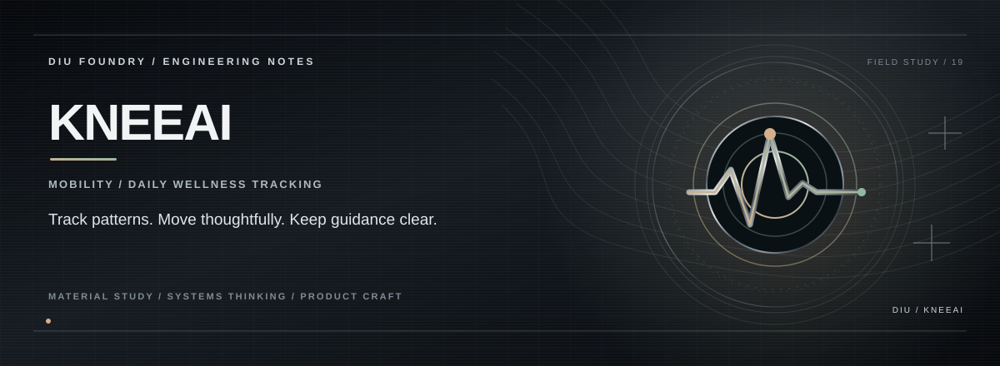

> **WELLNESS / TRACKING.**

## THE PREMISE

KneeAI turns a simple health-tech concept into an observable daily loop: record discomfort, capture mobility context, review a short trend and assemble a gentle movement session.

## THE EXPERIENCE

**KneeAI turns a simple health-tech concept into an observable daily loop: record discomfort, capture mobility context, review a short trend and assemble a gentle movement session.**

## THE SYSTEM

Track the day before judging the trend. | Make safety guidance part of the interface. | Keep the tool educational, not diagnostic.

## THE STACK

The MVP is a local-first static application using browser storage for check history and client-side calculations for trends and session planning.

## RUN

This repository is a static HTML, CSS and JavaScript prototype; no npm install is required.

Open `index.html` directly, or serve the project from the repository root:

```bash
python -m http.server 8000
```

Then visit `http://localhost:8000`.

## SAFETY NOTE

This is a wellness interface prototype, not a diagnostic tool or medical advice. A UI demonstration does not validate a clinical claim.

## PROJECT STATE

**HTML · CSS · JavaScript · localStorage**

This README intentionally distinguishes implemented behaviour from future integrations so the project can evolve without overstating what exists today.

---

<p align="center"><strong>K. KISHOR KUMAR</strong><br><sub>ENGINEERING / PRODUCT / SYSTEMS</sub></p>
